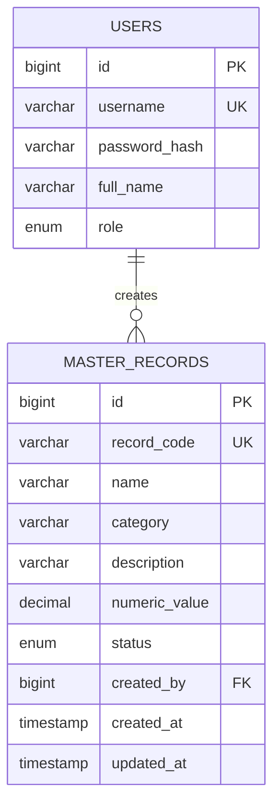
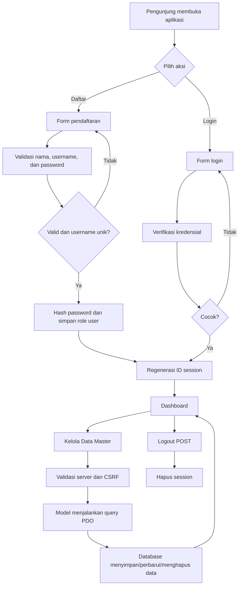

# Diagram Spesifikasi Program

Dokumen diagram awal untuk latihan. Revisi sesuai instruksi aktual dan jangan anggap entitas contoh ini sebagai ketentuan soal resmi.

## ERD sederhana

## Alur autentikasi

## Alur data CRUD

1. Form mengirim HTTP POST dengan token CSRF.
2. Controller mengambil dan memvalidasi input server-side.
3. Controller memanggil repository melalui `RecordRepositoryInterface`.
4. Model menggunakan PDO prepared statements untuk menjalankan SQL.
5. Controller menampilkan pesan hasil atau mengalihkan pengguna.
6. View melakukan escaping nilai dengan helper `e()` saat menampilkan data.
